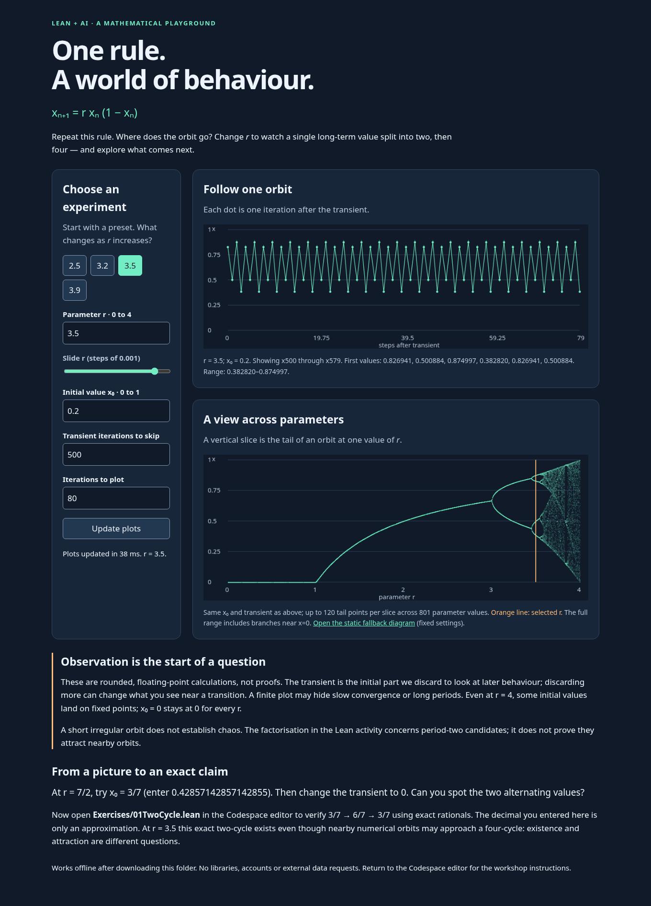

# Instructor validation

## Recorded checks (13 November 2026)

On the managed Linux development environment (3 reported CPUs), using the pinned
Lean 4.24.0 / Mathlib v4.24.0:

- `lake build` passed for the smoke test, rational cycle, real factorisation and
  interval-invariance solutions. A workshop-only clean rebuild took **9.8 s**;
  `#eval` printed `5` and `mkRat 1 2`.
- All three exercise files elaborated with only their deliberate `sorry` warnings.
  They are outside the verified import tree. Core suggested completions were also
  checked separately.
- Dependency pins were unchanged. Only the four required Mathlib import roots
  were requested, not the whole library: **791 cached modules**, **41 MiB** of
  compressed cache files here (the extracted Mathlib build directory was about
  **559 MiB**). These figures exclude Lean binaries, Git source and other packages.
- This environment's default Elan download and Azure cache requests received proxy
  errors. Local validation used the official Lean 4.24.0 release archive linked
  into Elan, a workspace-local `MATHLIB_CACHE_DIR`, and Mathlib's supported
  `USE_FRO_CACHE=1` mirror. Dependency versions and repository startup behaviour
  were unchanged. The final cache-fetch/setup pass took **23.4 s**, with the
  toolchain, source checkouts and cache executable already present; **this is not
  a cold Codespace startup measurement**.
- `node --test tests/explorer.test.cjs`: **6/6 passed**, covering iteration indexing,
  the rational-cycle numerical illustration, fixed-point/two-cycle examples,
  boundary values, invalid inputs and bifurcation sampling. These numerical tests
  are not formal proofs.
- Chromium/Playwright loaded the page through the documented Python HTTP server.
  It checked all presets, keyboard slider, input validation, transient indexing,
  the exact-cycle illustration, x₀ = 0, maximum settings, a 390-pixel viewport
  without horizontal overflow, offline controls, and the no-JavaScript SVG link.
  No page errors or external application requests occurred.
- Two browser runs took **1.0–1.1 s** for initial navigation + rendering; the
  largest permitted diagram (5000 transient steps, 801 slices, 120 retained
  points per slice) rendered in **94–309 ms**. These are observations on this
  machine, not performance guarantees for a two-CPU Codespace.



The committed [static fallback](../visualisation/fallback.svg) is generated by
`node scripts/generate-fallback.cjs` from the same numerical core as the explorer.
It uses x₀ = 0.2, 500 transient iterations and 80 retained points at 801 r values.
CI regenerates it and checks there is no diff.

## Fresh Codespace checks still required

A hosted Codespace was not created during this implementation. Before teaching,
use a **fresh Codespace on the PR/workshop branch**, preferably on the target
2-CPU configuration, and record cold/prebuilt startup times:

1. Wait for creation/setup to finish; confirm **Workshop ready** and no hidden
   setup failures. `Workshop/FirstSteps.lean` should open with Lean highlighting.
2. Confirm `#eval` outputs and Infoview goals; open `Exercises/01TwoCycle.lean`,
   replace the first `sorry` with `norm_num [logistic]`, and check **No goals**.
   Time this first success after setup. Repeat the second activity with
   `unfold logistic` followed by `ring`.
3. Run **F1 → Tasks: Run Task → Workshop: open numerical explorer**. Check the
   forwarded **8000** port opens the page in a browser tab while still Private;
   otherwise open it from the Ports panel. Confirm the base image's `python3`
   server starts, try every preset, then the fallback link. Stop/restart the task.
4. Run `lake build`. Confirm the PR's GitHub Actions build is green. Exercise
   warnings do not count as proved tasks; all solutions must be checked.
5. Rehearse the README's 30-minute route with a first-time Lean user. Review the
   difficulty of the optional stretch and the distinction between existence,
   attraction and numerical observations. Adjust pacing before adding content.

Configure a Codespaces prebuild for the delivery branch/region, and rehearse again
shortly before the session. Download the static SVG beforehand for projection if
needed; it is a numerical illustration and cannot replace the Lean activities.

## Repeat the browser checks (maintainers)

No test dependencies are needed by participants. In a maintainer environment
with **Playwright and Chromium already available**, start the documented server
from the repository root, then in a second terminal run:

```bash
node tests/browser.cjs
# Or use an existing system Chromium:
CHROMIUM_PATH=/usr/bin/chromium node tests/browser.cjs
```

This updates `docs/workshop-explorer.png`. The browser suite is optional tooling;
PR CI uses the dependency-free Node tests and pinned Lean build. The actual
Codespaces editor UI, task runner and port forwarding remain manual checks.
